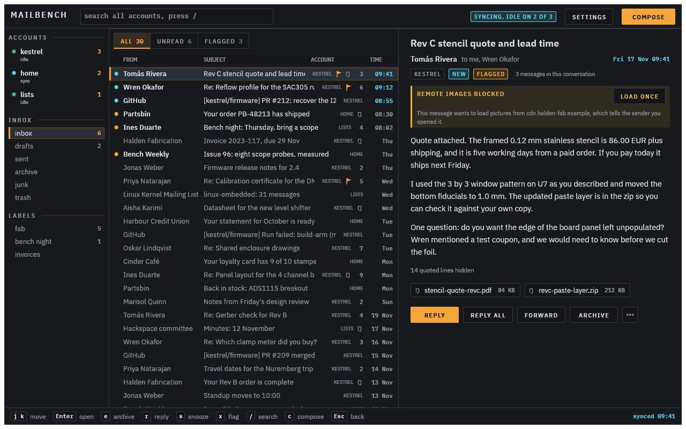

# mailbench

A keyboard-first desktop mail client, part of the [bench suite](https://github.com/v0l/bench-suite). It is meant to replace Thunderbird for daily mail.



- Every byte on disk is encrypted: messages, attachments, the search index, credentials and settings. The data key is unlocked by your OS keychain or a password. See [docs/storage.md](docs/storage.md).
- Messaging backends plug in behind one trait. IMAP (IDLE, CONDSTORE, STARTTLS and TLS) and SMTP (PLAIN, LOGIN and XOAUTH2) come first. See [docs/backends.md](docs/backends.md).
- Three panes: accounts and folders, a dense message list, and a reader. Remote images are blocked until you load them.

## Running it

```
cargo run --release
./target/release/mailbench
./target/release/mailbench --demo
```

The first start asks how to protect your mail (system keychain, a password, or both), then asks for your first account. Type the address and press detect: settings come from the provider autoconfig, the Mozilla ISP database, DNS SRV records or a Google/Microsoft guess. Test the connection, then save and sync. `--demo` shows sample mail and touches nothing.

Sign in with Google or Microsoft needs an OAuth client id at build or run time (`MAILBENCH_GOOGLE_CLIENT_ID`, `MAILBENCH_MICROSOFT_CLIENT_ID`, optional `..._CLIENT_SECRET`). Without one, use an app password.

Data lives in one encrypted file, `~/.local/share/mailbench/mail.db` on Linux (the platform data dir elsewhere, or `$MAILBENCH_DATA/mail.db`). To reset everything, quit the app and delete that file. The keychain entry (service `mailbench`) is then unused and can be removed with your keychain tool.

## Keys

| key | does |
| --- | --- |
| `j` `k` | move through the list |
| `Enter` | open |
| `e` | archive |
| `r` / `a` / `f` | reply, reply all, forward |
| `s` | snooze |
| `x` | flag |
| `c` | compose |
| `/` | search |
| `g a`, `g i` | go to archive, go to inbox |
| `Esc` | back |

## Build

```
cargo run --release
```

The backend tests start Greenmail and Dovecot in Docker:

```
cargo test
```

## Design

The design plan and the three concepts it was chosen from are in [docs/design.md](docs/design.md) and [docs/concepts/](docs/concepts/).

## Licence

GPL-3.0-only. The IBM Plex Sans font in `assets/` is under the SIL Open Font License.
